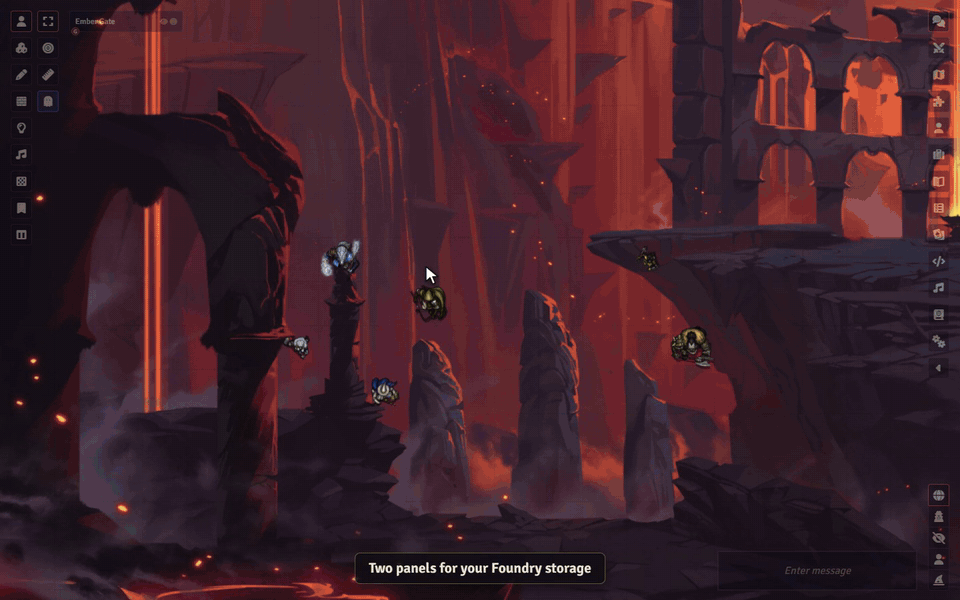

# Sephral’s File Commander

**Foundry's file picker is made for picking a file. File Commander is made for managing them.** Two panels side by side, full keyboard control and copying between folders, just like the classic commanders.

## Highlights

* **Two panels, one view:** browse two folders side by side, for example your asset collection on the left and your world on the right.
* **Copy whole folders:** copy single files or complete folder trees from one panel to the other. Before anything gets overwritten, it asks.
* **Keyboard first:** arrow keys, Enter, Tab and the classic F keys. F3 views, F5 copies, F7 creates a folder.
* **Upload where you are:** upload files from your computer straight into the active panel.
* **Look before you use:** images and videos open in Foundry's image viewer, audio files play in a small player.
* **Copy the path, paste it anywhere:** Ctrl+C copies the path the way Foundry expects it, ready for token images, tiles or playlist sounds.
* **Everywhere Foundry runs:** User Data, Public, S3 and the Assets Library on The Forge.

## How it works

1. Click the File Commander icon in the scene controls on the left, or open it from the module settings.
2. Pick a folder in each panel.
3. Select, copy, upload. Done.

## Good to know

Foundry does not let modules delete, move or rename files during a game session. File Commander sticks to what works safely everywhere: browse, copy, upload and create folders.

## Install

Search for **File Commander** in Foundry's module browser or open the [package page](https://foundryvtt.com/packages/sephrals-file-commander).

Foundry VTT v13 and v14 · any game system · English and German

## Learn more

The [manual](MANUAL.md) lists every hotkey and setting, the permissions players need and how it works on The Forge.

Questions or ideas? Join us on [Discord](https://discord.gg/7BjCgDYaBP). Looking for more? See [all modules by Sephral](https://github.com/Sephral).

## License

See [LICENSE.md](LICENSE.md).
